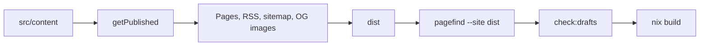

# chiloute.fr

Static blog for CTF writeups, security notes and small projects. Author: chiloute. The site is built with Astro in static mode (`output: 'static'`): no backend, no database, no accounts.

## Overview

| Area | Choice |
|---|---|
| Framework | Astro `^7.4.7` (static output) |
| Content | MDX via `@astrojs/mdx` `^8.1.3`, content collections with Zod |
| Styling | Tailwind CSS `^4.3.4` (`@tailwindcss/vite`) and `@tailwindcss/typography` |
| Code highlighting | Shiki dual themes (`github-light-default` / `github-dark-default`), styles moved to classes |
| Search | Pagefind `^1.6.0`, run after the Astro build |
| Feeds, sitemap | `@astrojs/rss`, `@astrojs/sitemap` |
| Social images | `satori` + `@resvg/resvg-js` (`src/pages/og/[...slug].png.ts`) |
| Tests | Node test runner (`src/**/*.test.ts`), Playwright + axe-core (`tests/`) |
| Language | TypeScript `^6.0.3` |

Why Astro 7 and not 6: Astro 7 is the current stable release, and the installed version is `7.4.7` (see `docs/api-verification.md`).

Markdown processor note: Astro 7 uses Satteri by default, which does not run rehype plugins. The site needs `rehype-external-links` (`rel="noopener noreferrer"` on external links), so `astro.config.mjs` sets `markdown.processor: unified(...)` from `@astrojs/markdown-remark`. MDX inherits this setting. Details and evidence: `docs/api-verification.md`.

### Build pipeline



`getPublished` (`src/lib/publishable.ts`) is the single gate for drafts. `npm run build` covers content to Pagefind; `npm run check:drafts` is a separate step (run by the Nix build after `npm run build`).

## Requirements

- Node.js 24 (`.nvmrc` contains `24`); `package.json` `engines.node` is `>=22.23.4`.
- npm (a `package-lock.json` is committed).

## Install and develop

```sh
npm ci
npm run dev
```

The dev server runs at `http://localhost:4321`.

### Nix / direnv (optional)

`flake.nix` provides a dev shell with Node 24 (no need for `nvm`), and `.envrc` loads it through direnv:

```sh
direnv allow   # once; or `nix develop` without direnv
```

Entering the shell installs the git hooks automatically (`.pre-commit-config.yaml` is generated and git-ignored). Pre-commit runs `eslint`, the unit tests, JSON and merge-conflict checks, the `ripsecrets` secret scanner (this repo is security-focused), and `actionlint` + `zizmor` on changes under `.github/`. Pre-push runs `astro check`. On Linux the shell also sets `PW_CHROMIUM_PATH` to the nixpkgs Chromium, so `npm run test:a11y` works on NixOS without a downloaded browser; on macOS Playwright uses its own browser. `nix flake check` runs only the cheap hooks, since the npm hooks need `node_modules`.

`shiki.css` (syntax highlighting colours) is generated at build time into `dist/shiki.css` (`src/integrations/shiki-css.mjs`). In dev, a middleware serves `/shiki.css` live, but rules accumulate as pages are rendered: reload a page after its first render to get code colours. Search (Pagefind) only works after `npm run build`, because the index is built from `dist`.

## Scripts

| Script | What it does |
|---|---|
| `npm run dev` | `astro dev`, development server |
| `npm run build` | `astro build && pagefind --site dist`: static site into `dist/`, then the search index |
| `npm run preview` | `astro preview`, serves `dist/` |
| `npm run check` | `astro check`, type and Astro diagnostics |
| `npm run lint` | `eslint .` |
| `npm test` | `node --test 'src/**/*.test.ts'`, unit tests |
| `npm run build:test` | Test-only build into `dist-test/` with drafts included (`BLOG_TEST_DRAFTS=1`). Never deploy it |
| `npm run test:a11y` | `playwright test`: axe-core on sample pages in both themes, plus behaviour tests. Needs a prior `npm run build:test` (the Playwright web server runs `astro preview --outDir dist-test`) |
| `npm run check:drafts` | `node scripts/check-drafts.mjs`: fails if a draft entry leaks into `dist/` |
| `npm run check:contrast` | `node scripts/check-contrast.mjs`: WCAG contrast of the tokens in `src/styles/global.css` (`--markdown` prints the table used in `docs/contrast.md`) |

One-off script, not in `package.json`: `node scripts/generate-icons.mjs` regenerates the icons in `public/` (output is committed).

Playwright needs a browser: `npx playwright install chromium`. Set `PW_CHROMIUM_PATH` to use a system Chromium instead.

## Project structure

```
src/
  config/        site.ts, projects.ts, hosting.ts
  content/       writeups/, notes/, projects/ (MDX)
  content.config.ts   collection schemas
  components/    Astro components; mdx/ holds Callout, Flag, Terminal, Spoiler
  layouts/       BaseLayout, PostLayout, LegalLayout
  pages/         routes, RSS, OG images, robots.txt, .well-known/security.txt
  lib/           publishable, projects, feeds, jsonld, dates, warn-config, ...
  integrations/  shiki-css.mjs
  scripts/       client scripts (theme, filters, search, copy, flag, ...)
  data/          projects.json (featured projects)
scripts/         check-drafts, check-contrast, generate-icons
tests/           Playwright specs
docs/            security, contrast, api-verification, manual a11y checklist
public/          static files (icons, pgp-key.txt, humans.txt)
.github/         CI workflows, shared setup action, Dependabot
```

## Configuration

### Contact email

Set `CONTACT_EMAIL` in `src/config/site.ts` (it is `TODO@example.invalid` until then). While it is the placeholder, the build prints a warning (`src/lib/warn-config.ts`). The same applies to the host details and `public/pgp-key.txt`. It is used in:

- `ContactEmail` component (obfuscated, assembled client-side by `src/scripts/email.ts`), shown on the legal notice, privacy, accessibility and about pages and in the footer;
- `/.well-known/security.txt` (`src/pages/.well-known/security.txt.ts`).

The JSON-LD (`src/lib/jsonld.ts`) does not currently include the email.

### Domain and other constants

`SITE_URL`, `AUTHOR`, `SITE_DESCRIPTION` in `src/config/site.ts`. `SITE_URL` feeds Astro's `site`, the sitemap, feeds and canonical URLs. Also in `site.ts`, each marked `TODO`:

- `socialLinks`: confirm the GitHub URL.
- `ctfProfiles`: set `url` and `enabled: true` per platform (Root-Me, HackTheBox, TryHackMe, CTFtime).
- `certifications`: replace the placeholder entry and set `enabled: true`.
- `cv`: set `path` (for example `/cv.pdf`) after adding the PDF to `public/`.

### Hosting identity

`src/config/hosting.ts` holds the host name, address, phone and website shown in the legal notice. All are `TODO` until a provider is chosen (`isHostPlaceholder`).

### Licences

`licenses` in `src/config/site.ts`: content CC BY-NC-SA 4.0, code MIT. The `LICENSE` file covers the code.

## Writing a writeup

Create `src/content/writeups/<slug>.mdx`. The file name is the URL slug (`/writeups/<slug>/`). The collection only loads `*.mdx` files.

### Frontmatter (writeups)

From `src/content.config.ts`:

| Field | Type | Required | Default |
|---|---|---|---|
| `title` | string | yes | |
| `description` | string | yes | |
| `ctf` | string | yes | |
| `date` | date (`z.coerce.date()`, for example `2026-10-12`) | yes | |
| `updated` | date | no | |
| `category` | `web` \| `pwn` \| `crypto` \| `forensic` \| `reverse` \| `misc` \| `osint` | yes | |
| `difficulty` | `easy` \| `medium` \| `hard` \| `insane` | yes | |
| `points` | number | no | |
| `tags` | array of strings | no | `[]` |
| `team` | string | no | |
| `draft` | boolean | no | `false` |

### Drafts

- `draft: true` excludes the entry from every listing, feed, sitemap, OG image and JSON-LD of `npm run build`. Drafts stay visible in `npm run dev` (and in the test-only `npm run build:test`), so you can preview them locally. Project MDX files (`src/content/projects/`) accept `draft` too.
- `npm run check:drafts` fails the build if a draft entry (slug or title) appears in `dist/`.

### Body

- Start headings at `h2` (`##`); the page title is the `h1`.
- Images need alt text (`alt=""` only for purely decorative ones).
- Import the components at the top of the file, after the frontmatter:

```mdx
import { Callout, Flag, Terminal, Spoiler } from '../../components/mdx';
```

Components (`src/components/mdx/`):

```mdx
<Callout type="warning" title="Scope">Text, with [links](https://example.org).</Callout>
```

`type`: `info` (default), `warning` or `tip`. `title` is optional.

```mdx
<Terminal
  title="Initial recon"
  prompt="$"
  commands={[
    { cmd: "curl -sI http://challenge.example.test/", output: "HTTP/1.1 200 OK" },
    { cmd: "id" },
  ]}
/>
```

`commands` is required; `output`, `title` and `prompt` (default `$`) are optional. The copy button copies commands only.

```mdx
<Spoiler title="Hint">Hidden until opened.</Spoiler>

<Flag value="EXAMPLE{flag_here}" label="Flag" />
```

`Spoiler` `title` defaults to `Spoiler`. `Flag` takes a required `value` and an optional `label` (default `Flag`). Without JavaScript the flag is a native `<details>`.

Fenced code blocks are highlighted by Shiki. See `src/content/writeups/example-web-ssti.mdx` for a full example, and `draft-example.mdx` for the draft gate.

## Adding a note

Create `src/content/notes/<slug>.mdx`. Frontmatter from the schema:

| Field | Type | Required | Default |
|---|---|---|---|
| `title` | string | yes | |
| `description` | string | yes | |
| `date` | date | yes | |
| `updated` | date | no | |
| `tags` | array of strings | no | `[]` |
| `draft` | boolean | no | `false` |

Same body rules as writeups. Example: `src/content/notes/linux-privesc-cheatsheet.mdx`.

## Adding a project

1. Add an entry to `projects` in `src/data/projects.json` (display order = file order): `repo` (`owner/name`), `description`, `homepage`, `stars`, `languages`, `updatedAt`, `license`. The file is edited by hand: the production build runs offline, so nothing is fetched from GitHub.
2. Optional: enrich the project page with `src/content/projects/<repo-name>.mdx` (file name = repository name; the build warns when no project matches). Frontmatter:

| Field | Type | Required |
|---|---|---|
| `draft` | boolean, default `false` (hidden from `npm run build`, shown in `npm run dev`) | no |
| `title` | string | no |

Example: `src/content/projects/example-repo-1.mdx`.

## Security

Summary (full rationale and host equivalents in `docs/security.md`):

- CSP in two parts: a `<meta>` policy generated by Astro (`security.csp`, hashed inline scripts and styles, `'wasm-unsafe-eval'` for Pagefind) and a header policy sent by nginx (`frame-ancestors`, `connect-src`, `object-src`, and so on).
- Other headers, also sent by nginx: HSTS, `nosniff`, Referrer-Policy, Permissions-Policy, COOP, CORP, X-Frame-Options. All of them, the cache rules and the `/sitemap.xml` redirect live in one place: `serverBlock` in `flake.nix`, checked with `nginx -t` by `nix flake check`.
- No inline styles and no `unsafe-inline`: Shiki output is converted to classes.
- No source maps (`vite.build.sourcemap: false`).
- Drafts check: `npm run check:drafts`.
- The headers have not been tested on a host yet; `docs/security.md` has the post-deploy checklist.

## Accessibility

The target is WCAG 2.2 AA in both themes (see `/accessibility/`, `src/pages/accessibility.astro`). The status is partial conformance pending a full audit.

- Automated: `npm run test:a11y` (axe-core with Playwright, Chromium only, light and dark) and `npm run check:contrast` (see `docs/contrast.md`).
- Manual: `docs/manual-a11y-checklist.md` (keyboard, NVDA + Firefox, VoiceOver + Safari, zoom and reflow, text spacing, reduced motion, forced colours).

## Deployment

The site is self-hosted: a NixOS container on the server builds the flake and serves `dist/` with nginx, exposed through a Cloudflare Tunnel (TLS at Cloudflare). There is no deploy job in CI.

- `packages.default` in `flake.nix` is the production `dist/`: `npm ci --ignore-scripts` from `package-lock.json` (`importNpmLock`, no npm hash to maintain), `npm run build`, then `npm run check:drafts`. Build it with `nix build github:Chiloute/cyber-blog`. It runs offline.
- Minimal container on the server's flake (inputs: `blog.url = "github:Chiloute/cyber-blog";`):

  ```nix
  containers.blog = {
    autoStart = true;
    privateNetwork = true;
    hostAddress = "10.233.1.1";
    localAddress = "10.233.1.2"; # cloudflared on the host points to http://10.233.1.2:80
    config = {
      imports = [ inputs.blog.nixosModules.default ]; # nginx: site, headers, cache, redirects
      networking.firewall.allowedTCPPorts = [ 80 ];
    };
  };
  ```
- Update: `nix flake update blog && nixos-rebuild switch` on the server. Nothing changes on the server without that step.
- Headers: Cloudflare Tunnel adds none; `nixosModules.default` brings them with the site, so they change with each `nix flake update blog`.
- CI workflows (`.github/workflows/`):
  - `ci.yml` (pull requests, pushes to `main`): `static` (lint, `astro check`, unit tests, `check:contrast`) must pass before `nix` and `e2e` start. `nix` runs `nix flake check`, which builds `packages.default` exactly as the server does (with `check:drafts`) and runs the cheap git hooks. `e2e` runs the Playwright a11y tests on the draft-inclusive test build. `ci-ok` fails if any of them failed or was skipped.
  - `security.yml`: `npm audit --audit-level=high` on lockfile changes and weekly.
  - `workflows-lint.yml`: actionlint and zizmor on changes under `.github/`.
- GitHub settings to enable manually: Dependabot alerts and Dependabot security updates; branch protection (or a ruleset) on `main` requiring the `ci-ok` status check, so a pull request cannot be merged unless `astro check`, the Nix build and `check:drafts` passed.

## Yearly maintenance

- Renew security.txt: update `securityTxt.expires` in `src/config/site.ts`. The build warns when fewer than 30 days remain and fails once it has expired. Keep the value under one year ahead. Also replace `public/pgp-key.txt` (currently a `TODO` placeholder) with the real ASCII-armored public key, and update it when the key changes.
- Review and merge Dependabot pull requests (`.github/dependabot.yml`: npm and GitHub Actions, weekly, grouped, versions younger than 7 days skipped). `flake.lock` (Nix inputs) is updated weekly by Dependabot too.
- Re-run the manual accessibility checklist and update the accessibility statement date.

## Commit convention

Conventional Commits: `feat:`, `fix:`, `docs:`, `chore:`, `refactor:`, `test:`. Dependabot uses `chore(deps)`.

## License

Code: MIT (`LICENSE`). Content (writeups, notes, text): CC BY-NC-SA 4.0 (https://creativecommons.org/licenses/by-nc-sa/4.0/).
